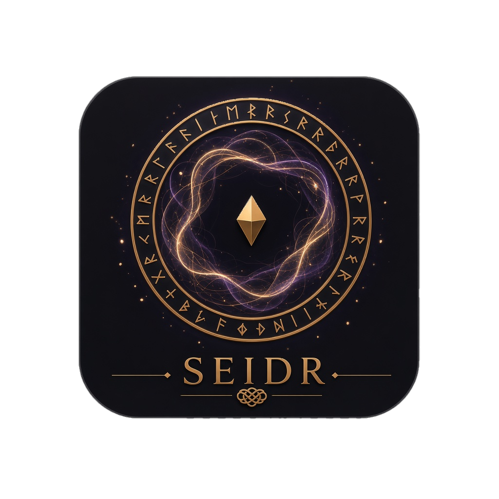
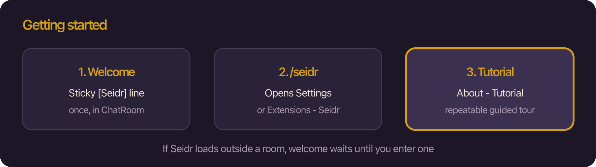
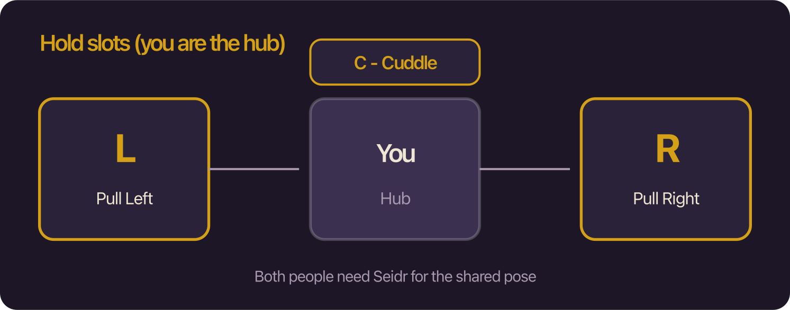
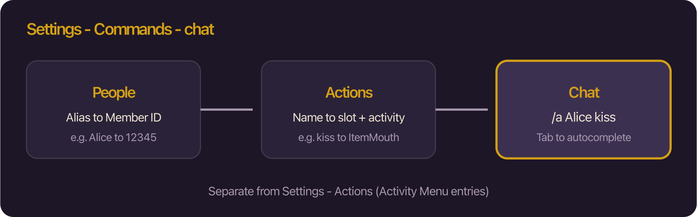
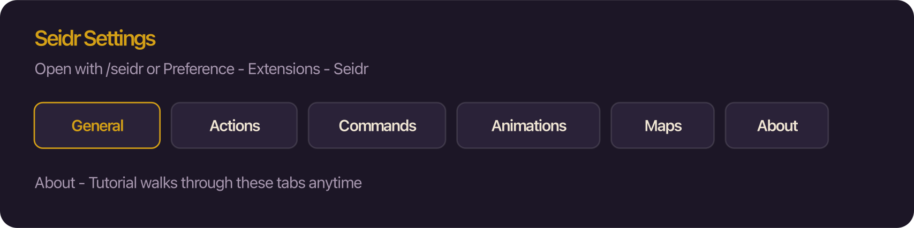

# Seidr



**Seidr** is a Bondage Club plugin for holds, undress, custom Activity Menu actions, chat slash commands, pose/face animations, room admin tools (including map versions), and related quality-of-life settings. Hold poses sync between Seidr peers; activity chat lines stay readable for everyone in the room, including clients without the mod.

| | |
|---|---|
| **Version** | 1.0.82 |
| **Author** | Freya |
| **Pages** | https://freya-bc.github.io/Freyas-Seidr/ |
| **FUSAM loader** | https://freya-bc.github.io/Freyas-Seidr/loader.js |

---

## Table of contents

1. [Install](#install)
2. [Getting started](#getting-started)
3. [Feature overview](#feature-overview)
4. [Holds](#holds)
5. [Undress](#undress)
6. [Custom Actions](#custom-actions)
7. [Animations](#animations)
8. [Chat Commands](#chat-commands)
9. [Fast Open](#fast-open)
10. [Room Manager](#room-manager)
11. [Settings](#settings)
12. [Echo coexistence](#echo-coexistence)
13. [Storage](#storage)
14. [Build (maintainers)](#build-maintainers)
15. [Detailed docs](#detailed-docs)

---

## Install

Use **one** of these after you are logged into Bondage Club:

| Method | How |
|--------|-----|
| **Bookmark (recommended)** | Copy the one-line `javascript:` URL from [`bookmark.js`](bookmark.js) into a browser bookmark. Click it in Club after login. Loads Pages: `seidr.js`. Click again after an update to reload. |
| **Tampermonkey** | Install [`seidr.user.js`](seidr.user.js), reload Club, log in. |
| **FUSAM** | Add [`loader.js`](loader.js) / see [`fusam-entry.json`](fusam-entry.json). Loads sibling `seidr.js` after login. |

Requires a ModSDK host such as **BCX** (hooks go through ModSDK; do not rely on raw Club wraps).

Open settings anytime with **`/seidr`** in chat, or **Preference → Extensions → Seidr**.

---

## Getting started



1. **Welcome** — The first time you enter a chat room with Seidr loaded, a sticky `[Seidr]` line appears in your **local** chat log (once per character). If Seidr loaded outside a room, the welcome waits until you enter one.
2. **Open Settings** — Type `/seidr` (or use Preference → Extensions → Seidr).
3. **Tutorial** — In Settings → **About**, click **Tutorial** for a guided tour of the tabs and chat autocomplete. You can run it again anytime (Skip / Esc to exit).

The in-app Tutorial is the fastest way to learn People, `/a` Actions, and Tab completion.

---

## Feature overview

| Area | What it does |
|------|----------------|
| **Welcome / Tutorial** | One-time chat welcome; About → Tutorial walks Settings + autocomplete |
| **Holds** | Pull Left / Right, Cuddle, Remove, Leave on Item Torso — shared poses for Seidr peers (45s reconnect grace on void disconnect) |
| **Undress** | Clothing-zone activities; Echo layers / “undress all” when those groups exist |
| **Custom Actions** | Up to 50 user activities in the Club Activity Menu (chat, conditions, icons, export/import) |
| **Animations** | Pose/face clips on you; play with `/animation` / `/ani` |
| **Chat Commands** | `/a` bindings, `/strip` / `/stripe`, `/poses` / `/p`, `/animation` / `/ani`, `/seidr`, `/roommanager` + Tab AC / Fast Select |
| **Fast Open** | Modifier-click a character to open Activity View on a chosen Item\* slot |
| **Room Manager** | Admin panel: room defs, access lists, backgrounds, map series + versions |
| **Maps (Settings)** | Library of map versions; Default can sync; other versions stay local |
| **Drawing / Names** | Pull / cuddle visual spacing; cluster nickname modes (Default / Hitbox / Hide / Hover) |
| **Arousal bars** | Hide / relocate Club (and BCTweaks) arousal meters |
| **Storage** | Compressed ExtensionSettings bag with usage breakdown |

---

## Holds

Open another character → **Item Torso** → **Activities**:



| Activity | Effect |
|----------|--------|
| **Pull Left** / **Pull Right** | Place them on that side. One person per slot; a new pull into a filled slot releases the previous person. |
| **Cuddle** | Close hold. Does not clear left/right. |
| **Remove Left / Right / Cuddle** | Clear that person from your slot. |
| **Leave** | Step out of someone else’s hold. |

- Gold **L / R / C** marks show who fills a slot; the shared button is outlined.
- Hands are **not** required for holds / remove / leave.
- **Both people need Seidr** for the shared pose. Without Seidr you still see chat lines and the normal lineup.
- Hitboxes and status stay on natural seats; only the drawn models use pull/cuddle offsets.
- **Void disconnect:** seats are kept ~**45 seconds** so a quick rejoin restores the pile. A normal room leave (or intentional Remove/Leave) clears immediately.

More detail: [`docs/HOLDS.md`](docs/HOLDS.md).

---

## Undress

Open the clothing zone for that slot (e.g. Item Torso for upper clothes, Item Boots for shoes). When the target wears that layer and you can change their clothes:

- An **Undress …** activity appears (label uses the worn item name).
- Hands are required.
- The target does **not** need Seidr. Chat is visible to the whole room.
- Echo extra layers appear only when those AssetGroups exist.
- When Echo adds a second layer for a family, **Undress all {family}** removes every layer in that family at once.

You can also undress from chat with `/strip` / `/stripe` (see Chat Commands).

More detail: [`docs/UNDRESS.md`](docs/UNDRESS.md).

---

## Custom Actions

Author under **Settings → Actions**. These appear in the **Club Activity Menu** (not a separate floating palette).

They are **different** from **Settings → Commands → Actions**, which are short names for `/a …` in chat.

- Up to **50** actions (`n/50` in the UI).
- **Other** / **Self** chat lines (max 500 characters) with Club token chips (`SourceCharacter`, `TargetCharacter`, `ActivityAsset`, …).
- Optional **items allowlist**, **conditions**, **arousal** template, **sound**, **pose**.
- **Icons**: Seidr SVG builtins or Club Activity icons.
- **Export / Import** clipboard envelopes (`SeidrAct1:` + LZ).

More detail: [`docs/ACTIONS.md`](docs/ACTIONS.md).

---

## Animations

Author under **Settings → Animations**. Clips play on **you** only.

- Up to **50** animations, **20** steps each, **60 s** total wait.
- Steps: **Pose** or **Face** + wait; optional Action text when the clip starts.
- Play: `/animation <name>` or `/ani <name>` (Tab autocomplete).

More detail: [`docs/ANIMATIONS.md`](docs/ANIMATIONS.md).

---

## Chat Commands



```
/a <member> <action>          # Settings → Commands bindings
/action <member> <action>
/stripe <member> <slot>       # undress one layer
/strip <member> <slot>        # layers + Undress all {family}
/poses <member> <pose>        # set Club pose
/p <member> <pose>
/animation <name>             # play your animation (self)
/ani <name>
/seidr                        # open Settings
/roommanager                  # open Room Manager
```

| Setup | What you do |
|-------|-------------|
| **People** | Alias → Member ID so you can type a short name instead of a number |
| **Commands → Actions** | Call name → slot + Club/Seidr/mod activity for `/a` |
| **Enable toggles** | Settings → General → Commands — turn each slash tag on/off |
| **Fast Select** | Letter + Tab (e.g. `a` then Tab → `/action `) when enabled |

| | |
|---|---|
| **Member** | Member ID, Commands → People alias, or room Name/Nickname. Multi-word: `"Long Nick"`. |
| **`/a` action** | Call name from **Settings → Commands → Actions**. |
| **`/strip` slot** | Clothing group (`Shoes`, `Cloth`, …) or `all:Cloth` for a family bundle. |
| **Pose / animation** | Shared pose catalog / your Animations list. |

**Tab** opens Seidr autocomplete (W/S or arrows, E/Enter, Esc). After `/poses`, Seidr posts a public Action line with unique Self/Other text.

More detail: [`docs/COMMANDS.md`](docs/COMMANDS.md).

---

## Fast Open

**Settings → General → Fast Open Actions** (on by default):

- Hold a modifier (**Shift** / Ctrl / Alt / Cmd) and click a character in the room.
- Opens Club Activity View on a preferred Item\* slot (default **ItemTorso**), then Activities mode.
- If Freyas Action Manager also uses Shift-click, FAM wins when both are loaded — change the modifier in Seidr if needed.

---

## Room Manager

For **room admins** (and on ChatAdmin create/edit):

| Entry | |
|-------|--|
| Chat room | Floating **⌂** (position from Settings; drag for this session) |
| ChatAdmin | Icon button near Club Save / BCX “More” |
| Settings | **Open Room Manager** · **`/roommanager`** |

**Areas:**

1. **Room Definition** — name, description, size, language, block categories, game, visibility, access mode, map mode.
2. **Room Access** — named Admin / Whitelist / Ban lists.
3. **Backgrounds** — named URL library with preview thumbs (thumbs stay in browser localStorage only).
4. **Maps** — when MapMode ≠ Never: map **series** + **versions**. Only **Default** syncs to the server; other versions (e.g. Development) stay local.

**Settings → Maps** manages the same library with Remote ↔ Local for Default and JSON import/export (imports are always Local only).

More detail: [`docs/ROOM_MANAGER.md`](docs/ROOM_MANAGER.md).

---

## Settings



**`/seidr`** or **Preference → Extensions → Seidr**

Tabs: **General** | **Actions** | **Commands** | **Animations** | **Maps** | **About**

### General

| Section | Options |
|---------|---------|
| **Fast Open Actions** | Enable, modifier, default Item\* slot |
| **Room Manager** | Activate master switch, show quickmenu ⌂, open panel |
| **Launcher position** | Top/Bottom/Middle × Left/Right, Chat Left / Top / Bottom |
| **Drawing** | Pull X/Y and Cuddle X/Y offsets (−400…400). **Names**: Default / Hitbox / Hide / Hover. Save Drawing to keep offsets |
| **Commands** | Per-slash enable toggles; Fast Select (letter + Tab); last-target memory |
| **Arousal bars** | Mode: Club default / Always hide / Show on change (1s) / Bottom bar. Scope: Self / Seidr holds / Everyone |
| **Storage** | Live KB usage vs ~180 KB cap; per-slice breakdown |

### About

Version, docs links, and **Tutorial** (repeatable guided tour).

More detail: [`docs/SETTINGS.md`](docs/SETTINGS.md).

---

## Echo coexistence

- Echo cuddle / pull tokens hide Seidr hold activities while those tokens are present.
- If Echo takes you (or someone you hold), Seidr **yields**: that hold clears and peers snap back.
- Bed and other Echo poses are left alone. Drawing offsets are Echo-style pair spacing only.

---

## Storage

Almost all Seidr data lives in one synced bag:

`Player.ExtensionSettings.SeidrRoomManager` (LZ-compressed)

| Soft limits | |
|-------------|--|
| Total bag | ~180 KB compressed |
| Maps share | at most **75%** of that budget (remote Default maps) |
| Named map series | soft-capped in UI; versions split remote Default vs local |
| Custom Activity Menu actions | ≤ 50 |
| Animations | ≤ 50 |
| Chat command people / actions | ≤ 50 each |

Background **preview thumbnails** and **local-only map versions** use browser localStorage (not the synced bag).

Room Manager footer and **Settings → Storage** show usage. Saving when full is refused with an error; delete or shrink data, then try again.

---

## Build (maintainers)

```bash
npm install
npm run build    # typecheck + esbuild + install artifacts
```

Requires Node 18+. Source is TypeScript under `src/` with `bc-stubs`. Public Releases are published to this repo’s GitHub Pages (`seidr.js` / `loader.js`).

---

## Detailed docs

| Doc | Topic |
|-----|--------|
| [`docs/HOLDS.md`](docs/HOLDS.md) | Pull / cuddle / remove / leave, badges, reconnect grace |
| [`docs/UNDRESS.md`](docs/UNDRESS.md) | Clothing undress + Echo layers |
| [`docs/ACTIONS.md`](docs/ACTIONS.md) | Custom Activity Menu actions |
| [`docs/ANIMATIONS.md`](docs/ANIMATIONS.md) | Pose/face animation clips |
| [`docs/COMMANDS.md`](docs/COMMANDS.md) | Slash commands, People, Tab autocomplete, Fast Select |
| [`docs/ROOM_MANAGER.md`](docs/ROOM_MANAGER.md) | Admin room / access / backgrounds / maps |
| [`docs/SETTINGS.md`](docs/SETTINGS.md) | Preference panel reference, Tutorial |

---

Not Freyas Seidr (the older Preference hub) and not Freyas Action Manager — Seidr is its own plugin. Load alongside BCX; manage overlapping Shift-click / map tools yourself if you also run FAM or Freyas Better Maps.
