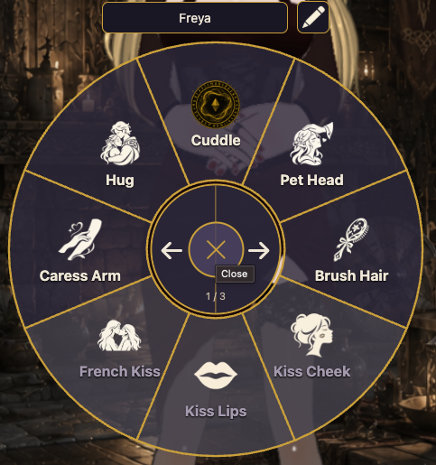
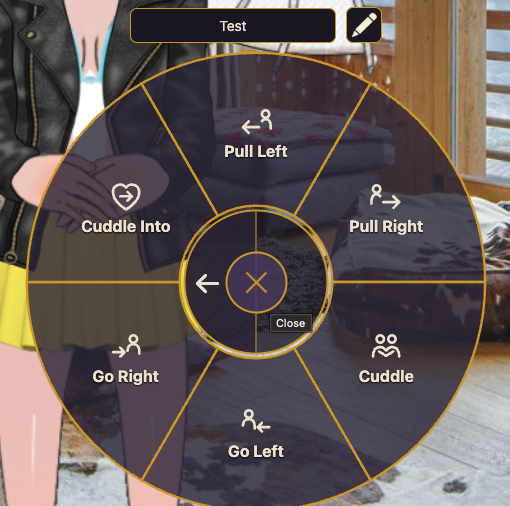
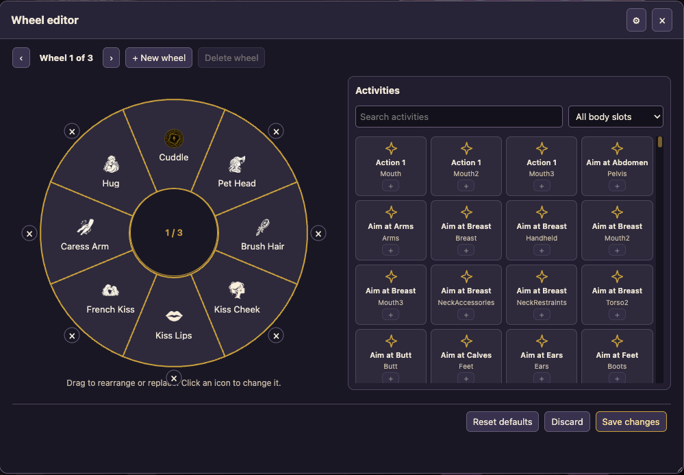
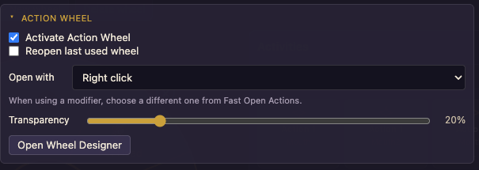

# Fast Action Wheel

The Fast Action Wheel gives you quick access to activities for yourself or another character. Open it in a regular chat room or a map room, choose an activity, and Seidr runs it for the selected character.

The screenshot shows one possible customized wheel. Your actions and icons can look different.

## Open the wheel

1. Make sure **Settings → General → Action Wheel → Activate Action Wheel** is enabled. It is on by default.
2. Right-click a character in the room or on the map. Right-clicking empty space does not open the wheel.
3. Select a segment to perform its activity. The wheel closes after a successful action.

You can change the opening gesture under **Settings → General → Action Wheel → Open with**:

| Gesture | How to open |
|---|---|
| Right click | Right-click a character. This is the default. |
| Middle click | Click a character with the mouse wheel or middle button. |
| Modifier + left click | Hold the selected Shift, Ctrl, Alt, or Cmd/Meta key and left-click a character. |

If you also use Fast Open Actions or another mod with a modifier-click shortcut, choose a different modifier to avoid a conflict. In map rooms, the wheel does not open over map controls or while you are editing the map.

## Choose and navigate actions

- The field above the wheel shows the selected character’s name. Hover an unavailable action to see its reason near the cursor, when one is available.
- Grey actions are currently unavailable. This can happen because an action is for yourself or another character, permissions or current conditions prevent it, or the action’s mod is inactive. A saved missing action stays in your layout so it can return when its mod is active again.
- Use the centre **left** and **right** arrows to switch wheels. The number shows the current wheel and total. You can also use the keyboard’s Left and Right arrows when chat is not focused.
- In map rooms, the wheel captures the arrow keys while open, so they do not move your character. Normal map controls return when it closes.
- Select the centre **×**, press **Escape**, or click outside the wheel to close it.
- Select the **pen** beside the name to open the Wheel Designer.

Seidr checks an activity’s availability again when you select it. The availability message may be general when Club or another mod does not provide a more specific reason.

## Hold menu

**Hold** is fixed at the top of wheel 1. Select it to open a second wheel with the Seidr pull, cuddle, join, and remove activities that are currently valid for the selected character and situation. Use the left arrow to return or **×** to close. If none are available, the field above the wheel says so. The screenshot of the main wheel shows the previous **Cuddle** label.

## Wheel Designer

You can open the Wheel Designer in either of these ways:

1. Open the Action Wheel on a character and click the **pen icon** to the right of the character’s name.
2. Open **Settings → General → Action Wheel** and click **Open Wheel Designer**.

The designer is a movable, resizable window. Drag its header to move it and drag its lower-right corner to resize it. The gear in the header opens Seidr Settings.

### Arrange activities

1. Use the arrows above the wheel to choose the wheel you want to edit. Select **+ New wheel** to add one, or **Delete wheel** to remove the current wheel. Wheel 1 cannot be deleted.
2. Search the **Activities** panel or filter it by body slot. It lists activities registered by Club, Seidr, and active mods. Where available, item requirements are shown on the activity.
3. Drag an activity from the right panel onto an empty segment to add it, or onto an occupied segment to replace it. The **+** button on an activity also adds it to the current wheel when there is room.
4. Drag an existing segment to another position to rearrange it. Use the small **×** outside a segment to remove that activity.
5. Click an activity’s icon to choose another icon. In that popup, **Move to wheel…** moves the activity to a different wheel with free space.
6. Select **Save changes** to apply your layout. **Discard** reloads the saved layout. **Reset defaults** loads the default layout into the editor; select **Save changes** to apply it.

Each wheel can hold up to eight actions, and you can create up to twelve wheels. Segments resize as the number of actions changes. The fixed Hold segment cannot be moved, replaced, removed, or assigned another icon.

### Default wheels

New configurations start with three wheels:

| Wheel | Actions |
|---|---|
| 1 | Hold, Pet Head, Brush Hair, Kiss Cheek, Kiss Lips, French Kiss, Caress Arm |
| 2 | Polite Kiss on Hand, Wiggle Body, Massage Back, Rub Bodies, Kiss Neck, Caress Breasts, Grope Breasts, Caress Nipple |
| 3 | Kiss Nipple, Caress Butt, Spank Butt, Grope Butt, Caress Clitoris, Masturbate Clitoris, Caress Pussy, Masturbate Pussy |

Some activities are available only for yourself or only for other characters. Their availability also depends on Club’s activity rules and the current situation. Existing custom layouts stay as you saved them until you change or reset them.

## Settings

Open **Settings → General → Action Wheel** to adjust these options:

| Setting | Default | Effect |
|---|---|---|
| Activate Action Wheel | On | Enables the opening gesture. |
| Reopen last used wheel | Off | Opens the last main wheel you used during the current browser session. Otherwise the wheel opens on wheel 1. |
| Open with | Right click | Chooses right click, middle click, or modifier + left click. |
| Modifier | Shift | Chooses the key used with modifier + left click. |
| Transparency | 20% | Adjusts the transparency of the wheel backgrounds. |
| Open Wheel Designer | — | Opens the layout editor. |

The layout and settings are saved with Seidr’s settings. The last used wheel is remembered for the current browser session, separately from the saved layout.
