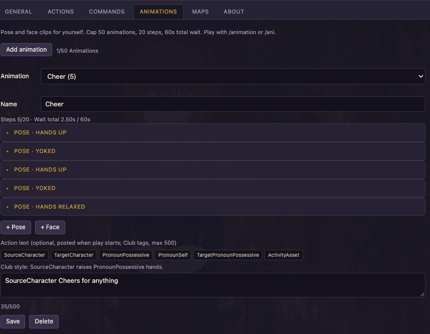
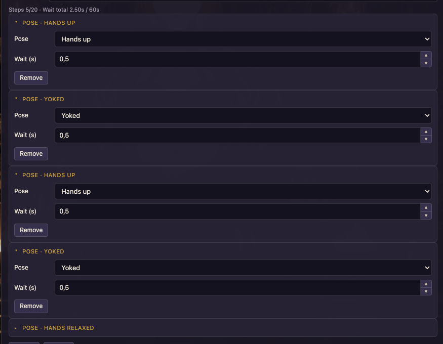
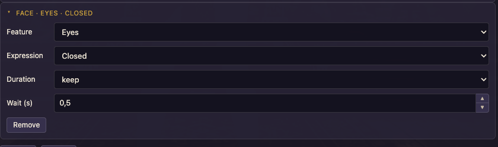
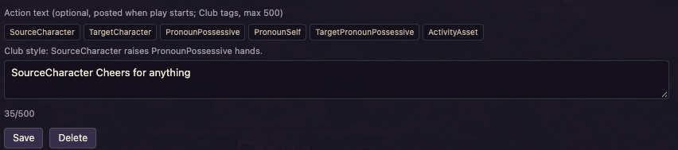

# Animations

Animations are short clips that play on **you** (the local Player). They do not pose other people in the room — use `/poses` for that.

Under **`/seidr` → Animations** you author:

1. **Pose / face / Wiggle-slot clips** — play with `/animation` or `/ani`.
2. **Wiggle sets** — Ear / Tail / Wing asset swaps used by those clips, Reactions, Fast Wiggle, and Action effects.



## When to use this

- Scripted pose or expression sequence on yourself (wave, blush, kneel then stand).
- Mix in **Wiggle** steps so ears / tail / wings react during the clip.
- Optional Action text can announce the clip to the room when it starts.

## Limits

| Limit | Value |
|-------|-------|
| Animations (clips) | 50 (`n/50` in the UI) |
| Wiggle sets | 50 (`n/50 Wiggles` — separate from clips) |
| Steps per clip | 20 |
| Total wait across steps | 60 seconds |
| Wiggle amount (per set) | 1–24 |
| Wiggle delay | 100–5000 ms |

## Creating a clip

1. Open **Settings → Animations**.
2. **Add** an animation (or pick one from the dropdown).
3. Set a **name** (what you type after `/animation` — keep it short and unique).
4. Add steps:
   - **Pose** — Club pose (Standing (legs), Hands up, Kneel, …) + wait seconds  
   - **Face** — feature (Eyebrows / Eyes / Mouth / Blush / Fluids), expression, duration (`keep` / 5 / 15 / 30), + wait  
   - **Wiggle** — check **Ear** / **Tail** / **Wing**; plays those configured Wiggle sets **at the same time** (any missing or not worn are skipped), then wait  
5. Optional **Action text** — public Club Action line when the clip **starts** (same token chips as Actions). Leave empty for silent play.  
6. **Save animation**.

Wait steppers nudge by small increments; the UI shows the total wait for the clip. Stay under the 60 s total.

### Pose steps



Each **+ Pose** row picks a Club pose and a **Wait (s)** before the next step. The header shows `Steps n/20 · Wait total … / 60s`.

### Face steps



Each **+ Face** row sets **Feature**, **Expression**, **Duration** (`keep` / timed), and **Wait (s)**.

### Wiggle steps

**+ Wiggle** adds Ear / Tail / Wing checkboxes. Configure the actual swap sets under **Animations → Wiggle** first. Example: check Ear + Tail so both wiggle together when the step runs; if only the tail is worn, only the tail plays.

### Action text



Optional line posted once when play starts (Club tags, max 500). Same token chips as Custom Actions.

## Playing

```
/animation wave
/ani wave
```

- Plays on **you only** (not on other room members).
- If Action text is set, the room sees that line once when playback starts.
- Name match is case-insensitive against your saved animation names (clips **and** named Wiggle sets).
- Tab autocomplete lists your animations while the command is enabled.

Unknown names warn locally in chat. Define them under Settings → Animations first.

## Wiggle (Ear / Tail / Wing)

Under **Animations → Wiggle**, add a set while wearing the **primary** item (Echo slots count).

1. **Add Ear / Tail / Wing** while that item is worn.  
2. Set the two frames:  
   - **Tail 1 / Tail 2** (next to Save) — equip that saved frame for 30s; press again to restore.  
   - **Capture first / Capture second** — store what you are wearing (same tail with another size/rotation/typed option is fine; or a different asset).  
   - **Automatch** — typed Top Left ↔ Top Right when available; otherwise Echo mirror.  
3. Colors: **Autoupdate** (default — dye from whatever you wear now; pose Property stays per frame) or **Snapshot**.  
4. Set **Amount** and **Delay**, then **Save**. **Test** from the editor — if the primary is not worn, Seidr equips it for the test and restores whatever was on that slot afterward.

Rules of thumb:

- One set per base item (e.g. one Fox Tail config).  
- Primary must be worn to play that slot.  
- Ear / Tail / Wing can run **together** (clip Wiggle step, Reaction Wiggle step, or overlapping plays).  
- Same item twice is OK when size, rotation, typed option, or show-modules differ.  
- Typed tails (Light Kitten, Fox/Raccoon straps, …) default to Top Left ↔ Top Right — no Echo mirror required.  
- Wings often have no mirror — use typed Spread/Folded or two different wing assets.  
- Stock sets are added automatically when missing (typed kitten/fox/raccoon tails, Echo mirror for other tails, ear pairs, **Black Kitty Ears - High** ↔ **Black Kitty Ears - Echo**, Elf Ears ↔ **Elf Ears 2**, typed Dragon wings). If a secondary never loads, install Echo (or the mod that adds it) — play reports **Asset counterpart is missing**.

## Fast Wiggle

**Settings → General → Fast Wiggle**: optional floating button (default position Chat Bottom).

- Shows only when a configured item is worn **and** its counterpart asset is available.  
- One ready slot → click plays it.  
- Several → a small menu to the left (same look as the Room Manager button).  
- Drag to move; position is saved on this device. Never overlaps the Room Manager ⌂.

## Enable / disable

**Settings → General → Commands** has separate toggles for `/animation` and `/ani`. Off = not registered / ignored.

Fast Select (when enabled) can map letter `d` + Tab to `/animation `.

## Common mistakes

- Expecting the clip to run on someone else — use `/poses` for other people.  
- Forgetting to **Save** before testing in chat.  
- Adding a Wiggle **step** without a matching Wiggle **set** for that slot — the step quietly skips.  
- Confusing this with the **pose** or **Play animation** effect on a Custom Action (Activity Menu) — related, but authored under Actions.

## Storage

Animations live in their own synced key `ExtensionSettings.SeidrAnimations`. See [SETTINGS.md](SETTINGS.md).

## Related

- [COMMANDS.md](COMMANDS.md) — `/animation` / `/ani`, `/poses` / `/p`  
- [ACTIONS.md](ACTIONS.md) — Activity Menu **Play animation** effect  
- [REACTIONS.md](REACTIONS.md) — Autoreaction Animation / Wiggle steps  
- [README.md](../README.md) — feature overview  
