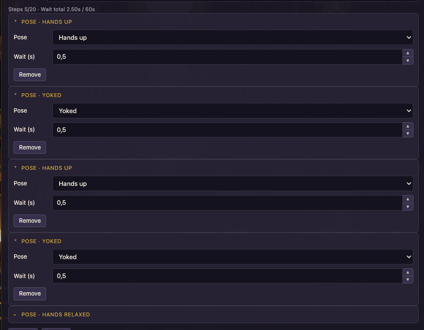
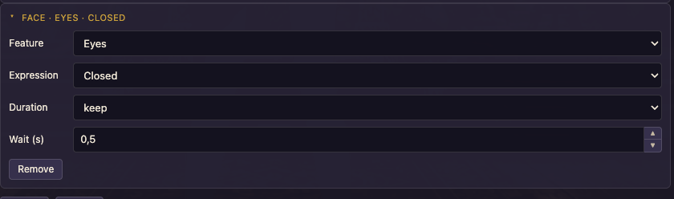
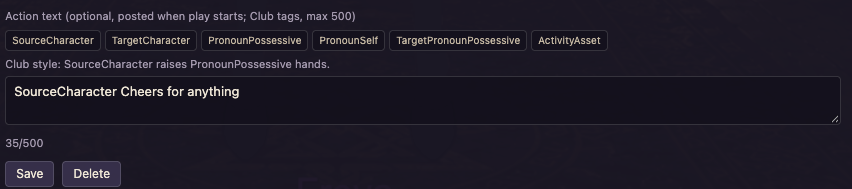

# Animations

Animations are short **pose and face** clips that play on **you** (the local Player). They do not pose other people in the room — use `/poses` for that.

Author under **`/seidr` → Animations**, then play from chat with `/animation` or `/ani`.


## When to use this

Use Animations for a scripted expression or pose sequence on yourself (wave, blush sequence, kneel then stand, and so on). Optional Action text can announce the clip to the room when it starts.

## Limits

| Limit | Value |
|-------|-------|
| Animations | 50 (`n/50` in the UI) |
| Steps per animation | 20 |
| Total wait across steps | 60 seconds |

## Creating an animation

1. Open **Settings → Animations**.
2. **Add** an animation (or pick one from the dropdown).
3. Set a **name** (this is what you type after `/animation` — keep it short and unique).
4. Add steps:
   - **Pose** — Club pose (friendly labels such as Standing (legs), Hands up, Kneel, …) + wait seconds  
   - **Face** — feature (Eyebrows / Eyes / Mouth / Blush / Fluids), expression, duration (`keep` / 5 / 15 / 30), + wait seconds  
5. Optional **Action text** — public Club Action line posted when the clip **starts** (same token chips as Actions: `SourceCharacter`, `PronounPossessive`, …). Leave empty for silent play.  
6. **Save animation**.

Wait steppers nudge by small increments; the UI shows the total wait for the clip. Stay under the 60 s total.

### Pose steps



Each **+ Pose** row picks a Club pose and a **Wait (s)** before the next step. The header shows `Steps n/20 · Wait total … / 60s`.

### Face steps



Each **+ Face** row sets **Feature**, **Expression**, **Duration** (`keep` / timed), and **Wait (s)**.

### Action text



Optional line posted once when play starts (Club tags, max 500). Same token chips as Custom Actions.

## Playing

```
/animation wave
/ani wave
```

- Plays on **you only** (not on other room members).
- If Action text is set, the room sees that line once when playback starts.
- Name match is case-insensitive against your saved animation names.
- Tab autocomplete lists your animations while the command is enabled.

Unknown names warn locally in chat. Define them under Settings → Animations first.

## Enable / disable

**Settings → General → Commands** has separate toggles for `/animation` and `/ani`. Off = not registered / ignored.

Fast Select (when enabled) can map letter `d` + Tab to `/animation `.

## Common mistakes

- Expecting the clip to run on someone else — use `/poses` for other people.
- Forgetting to **Save animation** before testing in chat.
- Confusing this with the **pose effect** on a Custom Action (Activity Menu) — different feature.

## Storage

Animations live in `ExtensionSettings.SeidrRoomManager` → `settings.animations` (same synced LZ bag as Actions / Room Manager). See [SETTINGS.md](SETTINGS.md).

## Related

- [COMMANDS.md](COMMANDS.md) — `/animation` / `/ani`, `/poses` / `/p`  
- [ACTIONS.md](ACTIONS.md) — Action Menu pose effect (different feature)  
- [README.md](../README.md) — feature overview  
