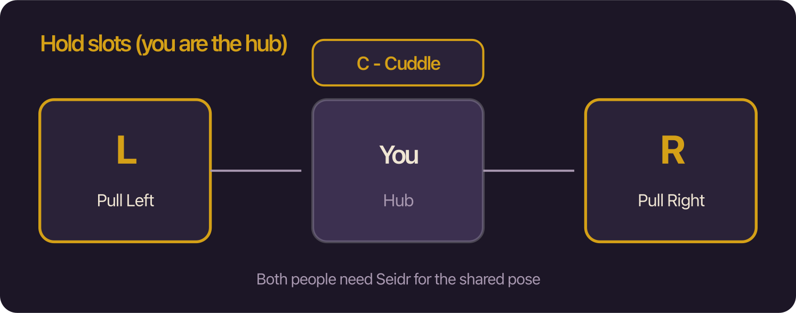

# Holds

Holds let you **Pull** someone to your left or right, **Cuddle** them close, or **Go** / **Cuddle Into** their slots yourself, with a shared pose that syncs between Seidr players. Everything lives in the normal Club **Activity** menu on **Item Torso** — no extra floating panel.

## When to use this

Use holds when you want a visible paired pose with another Seidr player in the same chat room. Chat lines still appear for everyone; the **drawn pose** only lines up for people running Seidr.

## Requirements

| | |
|---|---|
| Zone | **Item Torso** → Activities |
| Hands | Not required for holds / remove / leave |
| Peer Seidr | **Required** for the shared pose. Without it, chat still works and the lineup looks normal. |

## Activities

| Button | What happens |
|--------|----------------|
| **Pull Left** | Target moves to **your** left slot (you become the hub). |
| **Pull Right** | Target moves to **your** right slot. |
| **Cuddle** | Target moves into a close cuddle in front of **you**. Does **not** clear left/right. |
| **Go Left** | **You** move to the target’s left slot (they become the hub). |
| **Go Right** | **You** move to the target’s right slot. |
| **Cuddle Into** | **You** cuddle into the target (they become the hub). Does **not** clear their left/right. |
| **Remove Left / Right / Cuddle** | Clears that person from **your** corresponding slot (hub only). |
| **Leave** | You step out of **someone else’s** hold on you. |

### Slot rules

- **Pull / Cuddle** make **you** the hub. **Go Left / Go Right / Cuddle Into** make the **clicked person** the hub.
- Each of left, right, and cuddle can hold **one** person on a hub.
- Pulling or joining into an already filled side **releases** the previous person on that side.
- Cuddle / Cuddle Into do not kick people off left/right.
- A held person is not also a hub for someone else at the same time (Seidr keeps one cluster role per member). Joining while you already hub others abandons your pile.
- You must be free (not already held or hubbing) to use Go / Cuddle Into.

### Badges

- A gold **L**, **R**, or **C** mark on the activity button shows that slot is filled.
- On Pull / Remove, badges reflect **your** hub slots; on Go / Cuddle Into, they mark when **you** occupy that slot on the focused character.
- The button you share with that person is outlined so you can see the active hold at a glance.

## Pose vs hitbox

- **Drawn models** use Settings → Drawing offsets (pull spacing, cuddle lift).
- **Click hitboxes**, status icons, and arousal meters stay on **natural seats** so targeting stays reliable.
- Arousal meter clicks on clustered bodies are suppressed so you do not mis-click through a posed body.
- **Names** (Settings → Drawing): Default / Hitbox / Hide / Hover control only Club nicknames for people in a hold — not status icons or art.

## Sync

Hold state syncs with Hidden `Seidr` messages between Seidr clients (`hello`, `state`, and related). Activity chat uses Club’s dictionary path so roommates **without** Seidr still see the dialog line.

### Reconnect grace (void disconnect)

If someone **drops from the room without a clean leave** (refresh, kick, network void):

- Seidr keeps their left / right / cuddle seat for about **45 seconds**.
- If they **rejoin in time**, the pile restores (hub republishes; the returning client also asks peers for state).
- If the timer expires, the seat is cleared and everyone updates.

**Immediate clear** (no grace):

- They leave the room normally (`ChatRoomLeave` → Seidr leave-clear).
- You (or anyone) intentionally **Remove** / **Leave** / clear that seat while they are gone.

Grace only delays the *automatic* prune. A deliberate clear always wins.

## Tips

- Both of you need a current Seidr load for the cuddle/pull art to match.
- Echo cuddle/pull tokens make Seidr **yield** that hold — see the README Echo section.
- Open Settings with `/seidr` anytime; About → Tutorial walks holds and the rest of the UI.

## Related

- [SETTINGS.md](SETTINGS.md) — Drawing offsets, Names, arousal bars  
- [README.md](../README.md) — Echo yield, getting started  
