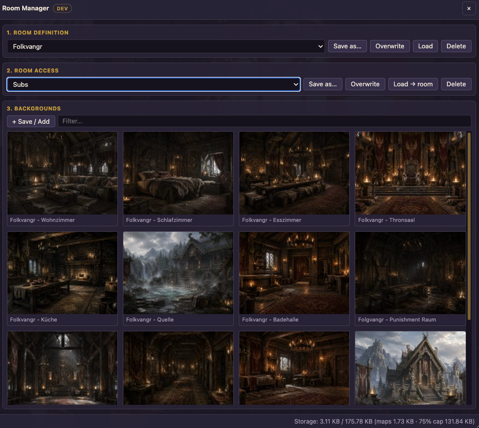
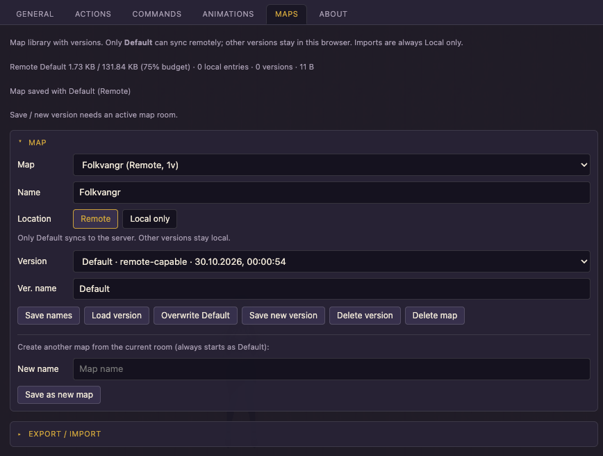
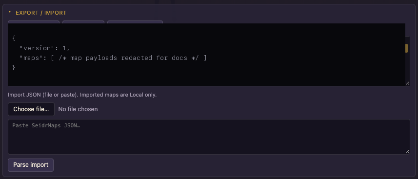

# Room Manager

Room Manager is a FAM-style HTML panel for **room admins**: save and load room definitions, access lists, custom backgrounds, and map payloads so you can rebuild or tweak rooms quickly.

Open it with **`/roommanager`**, the floating **⌂**, ChatAdmin’s Seidr button, or **Settings → General → Open Room Manager**.

## When to use this

Use Room Manager when you host or admin rooms and want reusable presets (name/description/size, ban lists, backgrounds, map versions) instead of retyping everything each time.

## How to open

| Context | Launcher |
|---------|----------|
| Chat room as admin | Floating **⌂** (Settings position; drag moves it for this session only) |
| ChatAdmin create / edit | Club-sized icon next to BCX “More” |
| Anywhere | **`/seidr` → General → Open Room Manager** or **`/roommanager`** |

The floating ⌂ is hidden on non-room screens, while a character dialog is open, or when **Show Quickmenu Button** / **Activate Room Manager** is off in Settings.

**Load** buttons work only on `ChatRoom` or `ChatAdmin`. Outside those screens you can still Save / Overwrite / Delete / Edit stored presets.

## Apply modes

| Mode | What Load does |
|------|----------------|
| **Creating** (ChatAdmin, not in a room) | Fills Club editor fields only — you still Save in Club |
| **Live room** (you are admin) | Applies values and sends Club `ChatRoomAdmin` **Update** |

If Load does nothing, check that you are admin and that Room Manager is activated in Settings.

## Areas

### 1. Room Definition

Named presets for room metadata, including:

- Name, Description, Size, Language  
- Block categories, Game, Visibility, Access mode  
- Map mode  

**Save as…** / **Overwrite** / **Load** / **Delete** with overwrite confirms where needed.

### 2. Room Access

Named **Admin**, **Whitelist**, and **Ban** member lists. Load applies lists and updates the live room when you are admin.

### 3. Backgrounds

Library of **name + URL** entries:

- Multi-row wrapping grid  
- Filter by name  
- Hover **Load** / **Edit**  
- Preview thumbnails cached in **browser localStorage only** (not synced)  

URLs must pass Club’s background validator and load as images.

### 4. Maps

Visible when the room’s MapMode is not Never:

- **Map** + **version** selects (versions keep the list from flooding)  
- Save as… creates **Default**; **Save new Version** is local-only; **Overwrite Default**; Load; Delete version / Delete map  
- Only **Default** syncs remotely; other versions stay in the browser  
- Uses FBM-style export / import strings under the hood  

**Common mistake:** editing a Development (local) version and expecting it to appear on another device — only **Default** (remote) syncs with your account.

### Settings → Maps

Library management (Map + Export/Import sections), Remote ↔ Local for Default, JSON export/import (always Local only).

See [SETTINGS.md](SETTINGS.md).

## Settings that affect Room Manager

| Setting | Default | Role |
|---------|---------|------|
| Activate Room Manager | On | Master switch for ⌂ and ChatAdmin button |
| Show Quickmenu Button | On | Floating ⌂ in the chat room |
| Launcher position | Chat Top | Default placement (left of chat edge for Chat positions) |

See [SETTINGS.md](SETTINGS.md).

## Storage

Remote presets and maps are stored in `Player.ExtensionSettings.SeidrRoomManager` (LZ) and synced with your account. Soft cap ~180 KB compressed. Local-only maps use `localStorage`. The panel footer shows usage; Settings → **Storage** breaks remote slices down (Maps row is remote only).

If a remote save would exceed the maps budget or the total cap, Seidr refuses the write and shows an error — nothing is synced until you free space or move maps to Local only.

## Related

- [SETTINGS.md](SETTINGS.md) — Storage breakdown, Maps tab  
- [README.md](../README.md) — Feature overview  
