# Settings

Seidr’s settings panel is the home for almost every option: Fast Open, Drawing, Map Cuddle, command toggles, custom Activity Menu actions, chat command bindings, animations, Reaction scripts, maps, and About.

Open it with:

- **`/seidr`** in chat (recommended), or  
- **Preference → Extensions → Seidr** (Seidr logo) — the panel returns you to the game after opening.

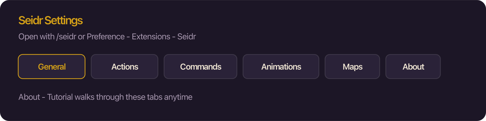

Tabs: **General** | **Actions** | **Commands** | **Animations** | **Reaction** | **Maps** | **About**.

---

## General

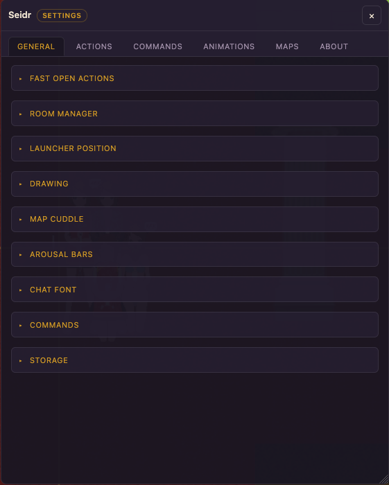

### Appearance

Choose **Seidr Classic** or **Plum & Gold** under Color scheme. The change applies immediately and is saved with your settings.

### Fast Open Actions

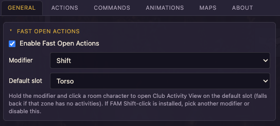

Jump into Club **Activity View** without hunting through the character menu.

| Option | Default | Meaning |
|--------|---------|---------|
| Enable | On | Modifier-click a room or map character opens Activity View |
| Modifier | Shift | Shift / Ctrl / Alt / Cmd (Meta) |
| Slot | ItemTorso | Preferred Item\* zone before switching to Activities mode |

Hold the modifier, click someone in the room or on the map. If Freyas Action Manager is also loaded and uses Shift-click, FAM’s handler wins on lineup when both bind Shift — pick another modifier here if that happens.

### Action Wheel

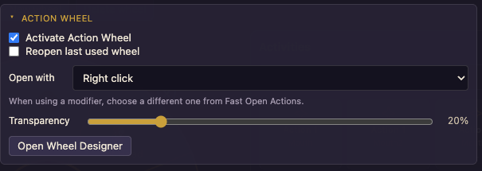

Open a customizable activity wheel for a character in a room or on a map. **Activate Action Wheel** is on by default. Choose right click, middle click, or a modifier with left click, and adjust transparency. **Reopen last used wheel** remembers the last main wheel for the current browser session and is off by default. **Open Wheel Designer** lets you arrange actions and icons.

See [Action Wheel documentation](ACTION_WHEEL.md) for the complete guide.

### Room Manager

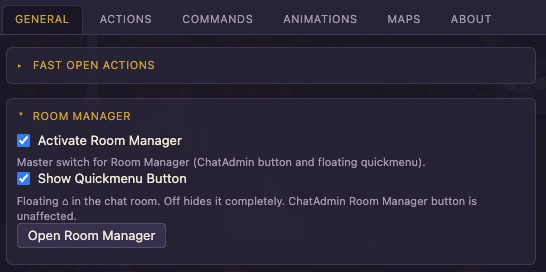

| Option | Default | Meaning |
|--------|---------|---------|
| Activate Room Manager | On | Master switch (floating ⌂ + ChatAdmin button) |
| Show Quickmenu Button | On | Floating ⌂ in ChatRoom; off hides it completely |
| Open Room Manager | — | Opens the admin panel from Settings |

Panel overview (definition / access / backgrounds):

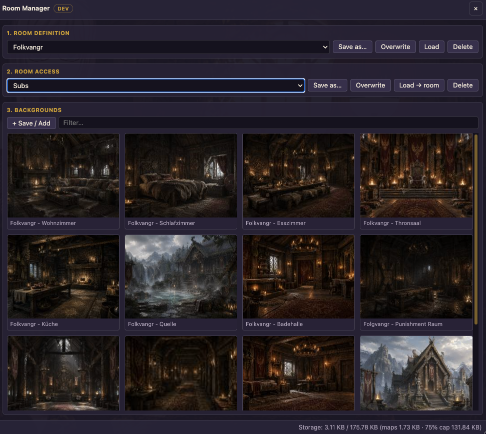

Details: [ROOM_MANAGER.md](ROOM_MANAGER.md).

### Launcher position

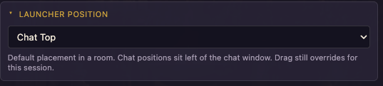

Default placement of the floating ⌂:

- Top / Bottom / Middle × Left / Right  
- **Chat Left**, **Chat Top**, **Chat Bottom** — sit left of the chat window edge  

Drag still overrides for the current session.

### Fast Wiggle

Optional floating button to play configured Ear / Tail / Wing wiggles (see [ANIMATIONS.md](ANIMATIONS.md)).

| Setting | Default | Meaning |
|---------|---------|---------|
| Show Fast Wiggle Button | Off | Floating control in ChatRoom; hidden when no matching item is worn |
| Position | Chat Bottom | Same placement options as the Room Manager launcher |

Drag saves on this device only. The button is always kept clear of the Room Manager ⌂. One ready slot → click plays it; several → a small menu to the left.

### Drawing

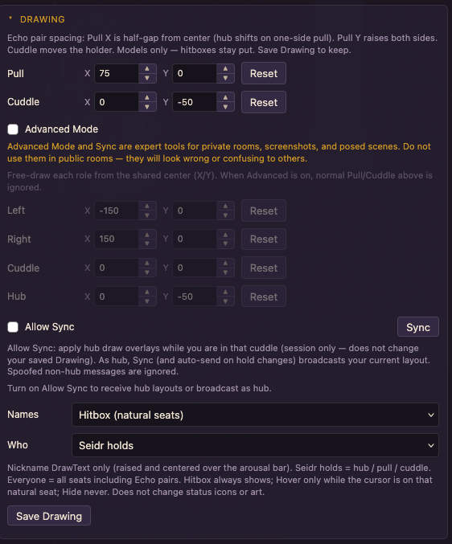

Echo-style **model** spacing for holds (hitboxes do not move):

| Control | Role |
|---------|------|
| Pull X | Half-gap from center (hub shifts on one-side pull) |
| Pull Y | Raises both sides |
| Cuddle X / Y | Moves the holder |
| **Names** / **Who** | Nickname modes + who they apply to (see below) |

Range −400…400 (Pull X stored as non-negative magnitude). Use the up/down steppers or type values to preview; click **Save Drawing** to persist.

#### Advanced Mode + Sync (expert)

**Advanced Mode** and **Allow Sync** are expert tools for private rooms, screenshots, and posed scenes. Do **not** use them in public rooms — they will look wrong or confusing to others.

| Control | Role |
|---------|------|
| **Advanced Mode** | When on, free-draw **Left / Right / Cuddle / Hub** X·Y from the shared center; normal Pull/Cuddle are greyed out and ignored. When off, normal Drawing is active again. |
| Left / Right / Cuddle / Hub | Independent signed offsets (−400…400). Saved with **Save Drawing**. |
| **Allow Sync** | Listen for hub `drawSync` overlays while you are in that cuddle. As hub, also auto-broadcast your layout whenever the hold changes. Off clears all session overlays. |
| **Sync** | Hub-only: push your current layout (Advanced free-draw if Advanced is on, otherwise a snapshot of normal Pull/Cuddle for this cluster). |

Synced layouts are **session-only** for that hub’s cuddle — they never overwrite your saved Drawing. Leave that hub (or turn Allow Sync off) and you are back to your own normal or Advanced settings. Only messages from the real hub MemberNumber are accepted; spoofed draw commands are ignored.

#### Names (nicknames)

Only Club **nickname** text is affected — not status icons, badges, or body art.

| Mode | Behaviour |
|------|-----------|
| **Default** | Follow Club / art placement |
| **Hitbox** (default) | Place the name on the natural seat (raised and centered over the arousal bar) |
| **Hide** | Do not draw the nickname |
| **Hover** | Show the name only while the cursor is over that natural seat |

| Who | Behaviour |
|-----|-----------|
| **Seidr holds** (default) | Hub, pull left/right, or cuddle only |
| **Everyone** | All character-view seats, including Echo pairs and people not in a Seidr hold |

**Names** and **Who** save immediately when you change either dropdown. Hitbox and Hover use the raised/centered placement.

### Map Cuddle

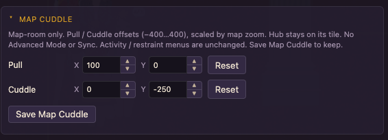

Map-room hold pose only (independent of lineup **Drawing**). Pull X/Y and Cuddle X/Y (−400…400; defaults Pull **100**, Cuddle Y **−250**). Values are scaled by map zoom so walking the camera and changing perception range stay stable. The **hub never moves** on the map. No Advanced Mode and no Sync on this section. Activity and restraint menu portraits are unchanged. Preview live; click **Save Map Cuddle** to persist.

Seat tiles, walk-back grace, and form/join rules: [HOLDS.md](HOLDS.md#map-rooms).

### Commands (enable toggles + Fast Select)

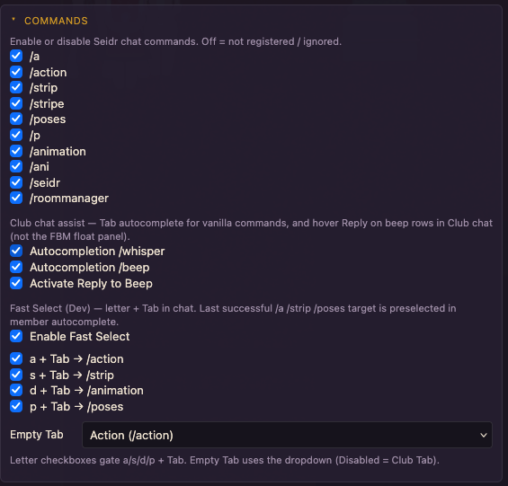

Collapsible **Commands** block on General:

1. **Enable toggles** — turn each slash tag on or off (`/a`, `/action`, `/strip`, `/stripe`, `/poses`, `/p`, `/animation`, `/ani`, `/seidr`, `/roommanager`, `/wardrobe`). Off = not registered / ignored. Keep `/seidr` on so you can always reopen Settings.
2. **Fast Select** (when shown) — type a letter then **Tab** to jump into a command (`a` → `/action `, `s` → `/strip `, …). Empty Tab is configurable. Per-letter checkboxes gate individual shortcuts.
3. **Last target** — after a successful `/a` / `/strip` / `/poses`, member autocomplete prefers that person next time (while they are still in the room).
4. **Club chat assist** (default on):
   - **Autocompletion /whisper** — Tab lists other people in the current room as `Name (ID)` (Club still sends the whisper).
   - **Autocompletion /beep** — Tab lists online friends as `Name (ID)` (Club still sends the beep).
   - **Activate Reply to Beep** — hover **Reply** on Club beep rows (in addition to Club’s ↩); prefills `/beep {id}` and shows the reply bar. Does **not** control Freyas Better Maps float-chat ↩.

Full chat guide: [COMMANDS.md](COMMANDS.md).

### Arousal bars

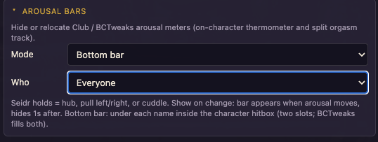

Controls Club / BCTweaks on-character thermometers and orgasm tracks.

| Mode | Behaviour |
|------|-----------|
| **Club default** | No Seidr override |
| **Always hide** | Hide meters for the chosen scope |
| **Show on change** | Show when arousal moves; hide ~1s after |
| **Bottom bar** | Draw under each name inside the character hitbox (two slots; BCTweaks can fill both) |

| Scope | Who is affected |
|-------|-----------------|
| **Self only** | You |
| **Seidr holds** | You and people in your Seidr hold cluster |
| **Everyone** | All characters drawn in the room |

“Seidr holds” means hub, pull left/right, or cuddle involvement.

### Chat font

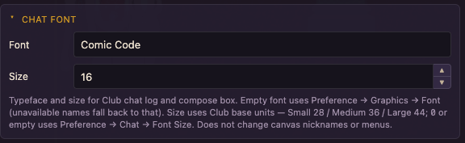

| Option | Default | Meaning |
|--------|---------|---------|
| Font | (empty) | Typeface for Club chat log and compose box |
| Size | `0` / empty | Club-base size override (Small **28** / Medium **36** / Large **44**) |

Empty **Font** uses **Preference → Graphics → Font**. Enter an installed system font name (e.g. `Comic Code`, `Georgia`). If that face is missing on this device, Club’s Graphics font is used instead.

**Size** `0` or empty uses **Preference → Chat → Font Size**. Non-zero values use the same canvas scaling as Club (`base × min(canvasW, canvasH) / 1000`) on the **log and compose text only** — chat buttons and chrome keep Club sizing. Does not change canvas nicknames or menus.

Example with a custom face applied to action lines, chat, and emotes:

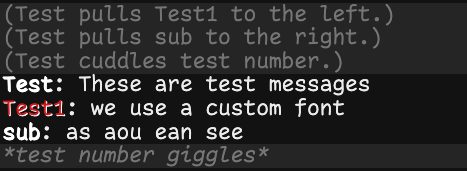

### Unread badge

| Option | Default | Meaning |
|--------|---------|---------|
| Clear unread badge when focusing chat | On | Clears Club’s **Chat Message** tab/favicon notification count when you return to this browser tab or focus the chat compose box |

Vanilla Club only clears that count when the window is focused **and** the chat log is scrolled to the bottom. With this on, focusing compose (or returning to the tab) clears the badge even if you were reading history. Does not change Friend List / beep unread.

### Cheats

Collapsible **Cheats** block on General (self only):

| Action | Meaning |
|--------|---------|
| **Give all Items** | Confirm, then add every missing Club inventory item (`AssetFemale3DCG` / Male catalog, `InventoryAdd` with `Push=false`), then one `ServerPlayerInventorySync`. Progress text updates while scanning. Does not wear anything. |

### Storage

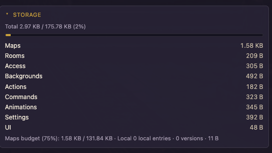

Read-only usage for the synced ExtensionSettings data (all Seidr keys together):

- Total stored size vs ~180 KB soft cap (+ thin progress bar)  
- Rows: **Maps** (remote only), **Rooms**, **Access**, **Backgrounds**, **Actions**, **Commands**, **Animations**, **Reactions**, **Settings**, **UI**  
- Maps **75%** budget line (+ local maps note when present)  

Refreshes when you open / refresh Settings. Saving when full is refused until you free space.

---

## Maps tab

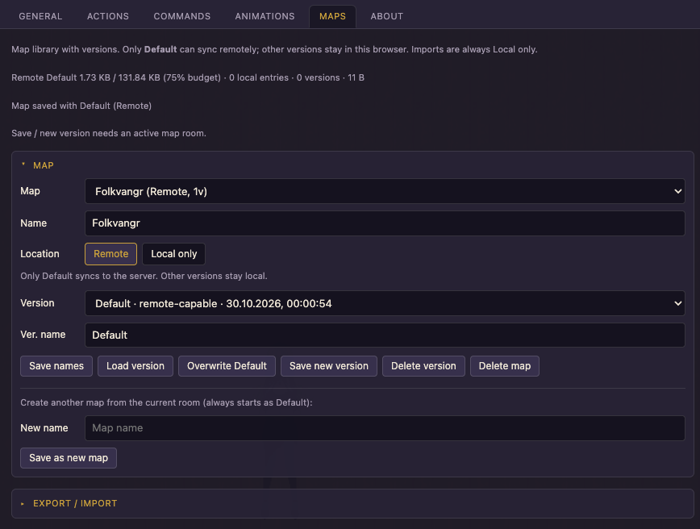

Manage Room Manager map **series** and **versions** (collapsible **Map** and **Export / Import**):

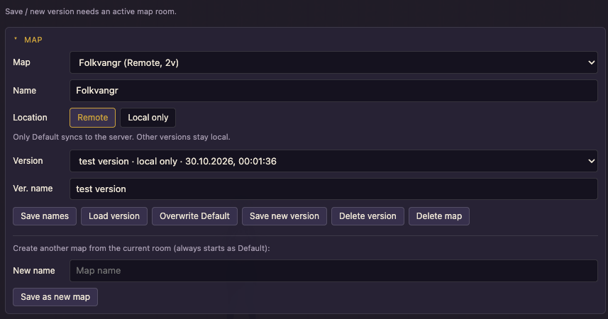

- Save the current map room as a new map — version is always **Default** (disabled outside a map room)  
- Only **Default** can sync to the server; other versions (e.g. Development / named local versions) stay in this browser  
- Toggle **Remote** vs **Local only** for Default; **Overwrite Default**; Save new version; Load / Delete  

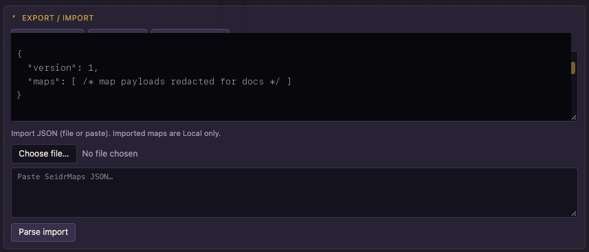

- Export JSON (refresh / copy / download); **Choose file…** or paste — imports are **always Local only**  

Details: [ROOM_MANAGER.md](ROOM_MANAGER.md).

---

## Actions tab

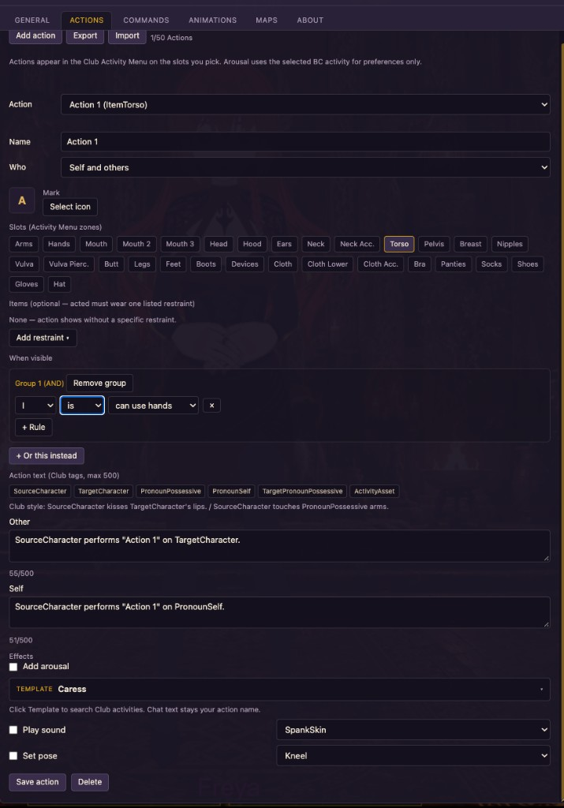

Full editor for **custom Activity Menu** entries (up to 50): identity, slots, chat, items, conditions, arousal template, sound, pose, icons, export/import.

These are **not** the same as **Commands → Actions** (those are `/a` shortcuts). Per-section screenshots and walkthrough: [ACTIONS.md](ACTIONS.md).

---

## Commands tab

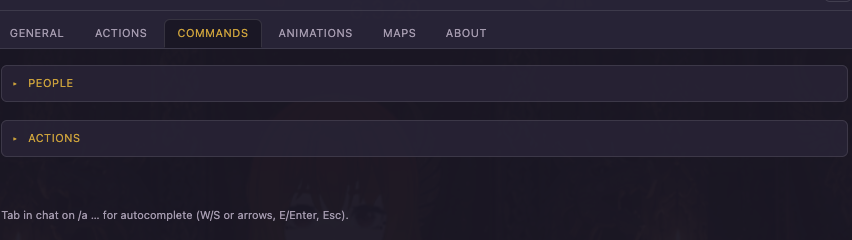

Chat slash-command setup: **People** aliases and **`/a` Action** bindings. Tab in chat on `/a …` for autocomplete (W/S or arrows, E/Enter, Esc).

### People — what to do

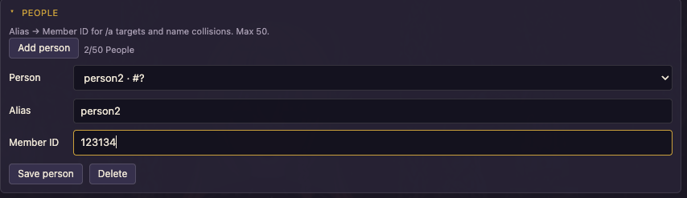

1. Click **Add person**.
2. Set an **Alias** (short name you type in chat) and **Member ID**.
3. **Save person**.
4. Use the Person dropdown later to edit or delete.

Aliases help when several people share a display name — Seidr resolves the Member ID you saved. Max **50**.

### Actions — what to do

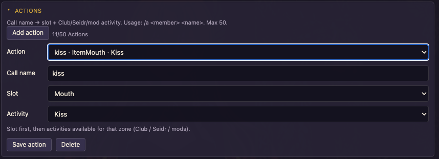

1. Click **Add action**.
2. Set a **call name** (what you type after the person in `/a`).
3. Pick **Slot** first (e.g. Mouth), then **Activity** for that slot.
4. **Save action**.

Pose / animation / undress / meta commands do **not** need rows here — they use built-in lists or the Animations tab. Max **50**.

In the chat box, **Tab** opens autocomplete. Full guide: [COMMANDS.md](COMMANDS.md).

---

## Animations tab

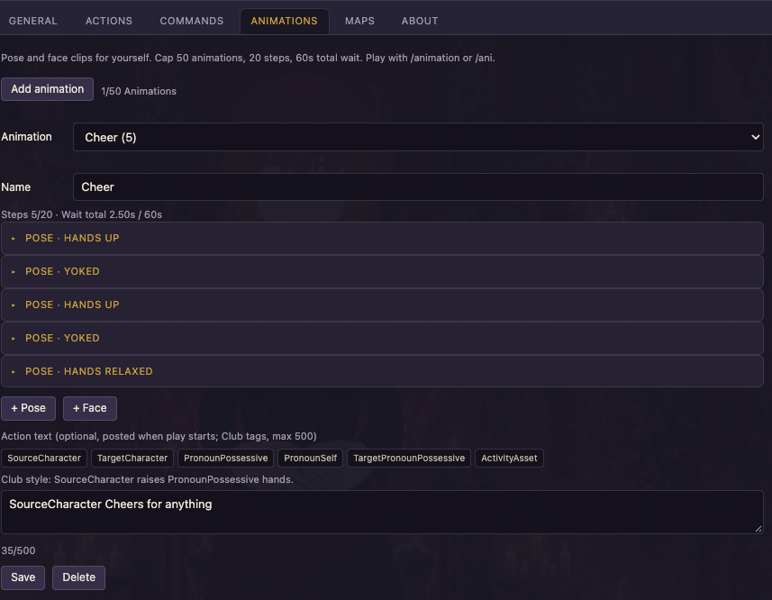

Two sections in one bag (up to **50** total):

- **Animations** — pose / face / **Wiggle-slot** clips (20 steps, 60 s total wait). Play with `/animation` / `/ani`.  
- **Wiggle** — Ear / Tail / Wing asset-swap sets (one per base item) used by clips, Reactions, Fast Wiggle, and Action effects.

Full guide (steps, wings typed Spread/Folded, Fast Wiggle): [ANIMATIONS.md](ANIMATIONS.md).

---

## Reaction tab

Local Autoreaction scripts (up to **50**). Each reaction can trigger when:

- you **perform** a listed Club activity, and/or  
- that activity is **performed on you** (optional **Slot** filter, e.g. Ears), and/or  
- **you** say an exact chat Phrase (case-insensitive), and/or  
- **you** orgasm, are denied, or resist, with separate toggles for each.

The response is a script of up to **5** steps run in order on your client only:

1. **Say** — normal chat line  
2. **Animation** — play a clip or a single named Wiggle set from the Animations tab  
3. **Wiggle** — Ear / Tail / Wing checkboxes; plays those sets together (skips missing / not worn)  
4. **Perform action** — a Commands Action binding, targeting **Self** or the **Issuer** (the other party of the activity; for Phrase triggers, Issuer is you)

Before running, Seidr checks that animations exist and actions are available. If not, a local chat toast reports `Reaction "…" not functional: …`. The script itself is not synced to other players; its chat, actions, pose changes and item swaps can still be visible in the room.

Full guide: [REACTIONS.md](REACTIONS.md).

---

## About tab

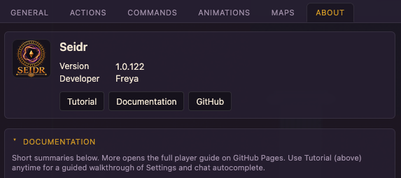

Plugin identity and documentation:

- **Version** (matches the loaded Seidr build) and **Developer** (Freya)  
- **Tutorial** — repeatable spotlight walkthrough of Settings and chat autocomplete (Skip / Esc anytime)  
- **Documentation** / **GitHub** — Pages home and public repository  
- Short feature blurbs with **More** → opens the matching Pages guide in a new tab  

First load in a chat room also posts a one-time sticky **Welcome** line in local chat (mentions `/seidr` and this Tutorial).

---

## Where settings are stored

All of the above (except background preview thumbs, **local-only** map versions and panel position/size) persist in:

`Player.ExtensionSettings.SeidrRoomManager` (rooms, access, backgrounds, maps), `SeidrSettings`, `SeidrActions`, `SeidrCommands`, `SeidrAnimations`, `SeidrReactions`

Synced with your BC account via Club ExtensionSettings; changes are uploaded after a short delay and only for the part that changed. Preview thumbnails, local-only map versions and the Room Manager panel position/size use **localStorage**.
