# Settings

Seidr’s settings panel is the home for almost every option: Fast Open, Drawing, command toggles, custom Activity Menu actions, chat command bindings, animations, maps, and About.

Open it with:

- **`/seidr`** in chat (recommended), or  
- **Preference → Extensions → Seidr** (Seidr logo) — the panel returns you to the game after opening.

Tabs: **General** | **Actions** | **Commands** | **Animations** | **Maps** | **About**.

---

## General

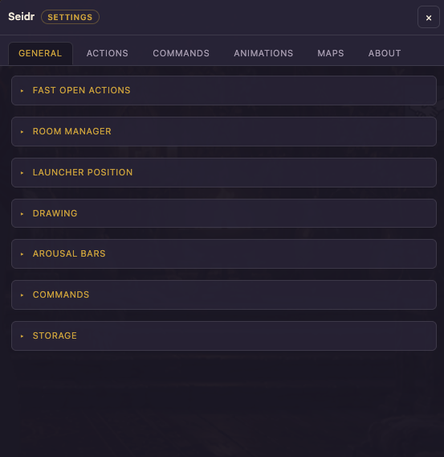

### Fast Open Actions

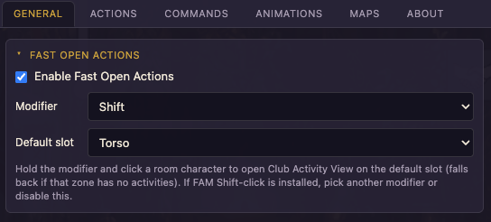

Jump into Club **Activity View** without hunting through the character menu.

| Option | Default | Meaning |
|--------|---------|---------|
| Enable | On | Modifier-click a room character opens Activity View |
| Modifier | Shift | Shift / Ctrl / Alt / Cmd (Meta) |
| Slot | ItemTorso | Preferred Item\* zone before switching to Activities mode |

Hold the modifier, click someone in the room. If Freyas Action Manager is also loaded and uses Shift-click, FAM’s handler wins when both bind Shift — pick another modifier here if that happens.

### Room Manager

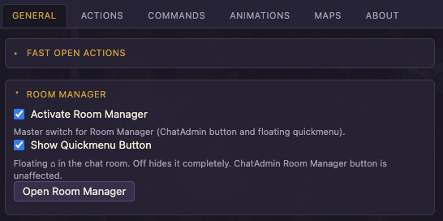

| Option | Default | Meaning |
|--------|---------|---------|
| Activate Room Manager | On | Master switch (floating ⌂ + ChatAdmin button) |
| Show Quickmenu Button | On | Floating ⌂ in ChatRoom; off hides it completely |
| Open Room Manager | — | Opens the admin panel from Settings |

Details: [ROOM_MANAGER.md](ROOM_MANAGER.md).

### Launcher position

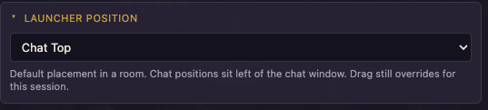

Default placement of the floating ⌂:

- Top / Bottom / Middle × Left / Right  
- **Chat Left**, **Chat Top**, **Chat Bottom** — sit left of the chat window edge  

Drag still overrides for the current session.

### Drawing

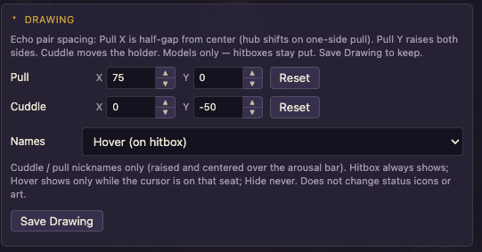

Echo-style **model** spacing for holds (hitboxes do not move):

| Control | Role |
|---------|------|
| Pull X | Half-gap from center (hub shifts on one-side pull) |
| Pull Y | Raises both sides |
| Cuddle X / Y | Moves the holder |
| **Names** | Cluster nicknames only (see below) |

Range −400…400 (Pull X stored as non-negative magnitude). Use the up/down steppers or type values to preview; click **Save Drawing** to persist.

#### Names (cluster nicknames)

Only Club **nickname** text for people in a Seidr hold is affected — not status icons, badges, or body art.

| Mode | Behaviour |
|------|-----------|
| **Default** | Follow Club / art placement |
| **Hitbox** (default) | Place the name on the natural seat (raised and centered over the arousal bar) |
| **Hide** | Do not draw the nickname |
| **Hover** | Show the name only while the cursor is over that natural seat |

**Names** saves immediately when you change the dropdown. Hitbox and Hover use the raised/centered placement.

### Commands (enable toggles + Fast Select)

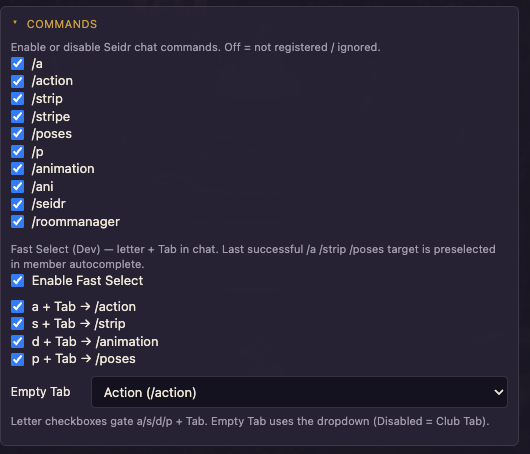

Collapsible **Commands** block on General:

1. **Enable toggles** — turn each slash tag on or off (`/a`, `/action`, `/strip`, `/stripe`, `/poses`, `/p`, `/animation`, `/ani`, `/seidr`, `/roommanager`). Off = not registered / ignored. Keep `/seidr` on so you can always reopen Settings.
2. **Fast Select** (when shown) — type a letter then **Tab** to jump into a command (`a` → `/action `, `s` → `/strip `, …). Empty Tab is configurable. Per-letter checkboxes gate individual shortcuts.
3. **Last target** — after a successful `/a` / `/strip` / `/poses`, member autocomplete prefers that person next time (while they are still in the room).

Full chat guide: [COMMANDS.md](COMMANDS.md).

### Arousal bars

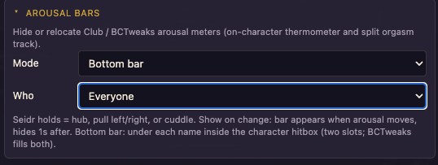

Controls Club / BCTweaks on-character thermometers and orgasm tracks.

| Mode | Behaviour |
|------|-----------|
| **Club default** | No Seidr override |
| **Always hide** | Hide meters for the chosen scope |
| **Show on change** | Show when arousal moves; hide ~1s after |
| **Bottom bar** | Draw under each name inside the character hitbox (two slots; BCTweaks can fill both) |

| Scope | Who is affected |
|-------|-----------------|
| **Self only** | You |
| **Seidr holds** | You and people in your Seidr hold cluster |
| **Everyone** | All characters drawn in the room |

“Seidr holds” means hub, pull left/right, or cuddle involvement.

### Storage

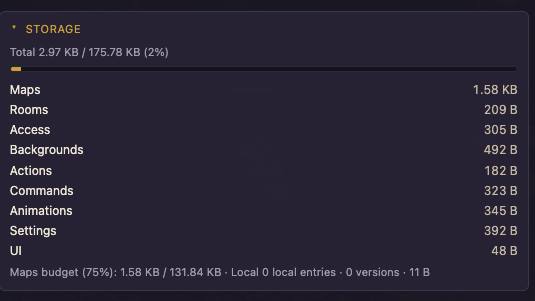

Read-only usage for the synced ExtensionSettings bag:

- Total compressed size vs ~180 KB soft cap (+ thin progress bar)  
- Rows: **Maps** (remote only), **Rooms**, **Access**, **Backgrounds**, **Actions**, **Commands**, **Animations**, **Settings**, **UI**  
- Maps **75%** budget line (+ local maps note when present)  

Refreshes when you open / refresh Settings. Saving when full is refused until you free space.

---

## Maps tab

Manage Room Manager map **series** and **versions** (collapsible **Map** and **Export / Import**):

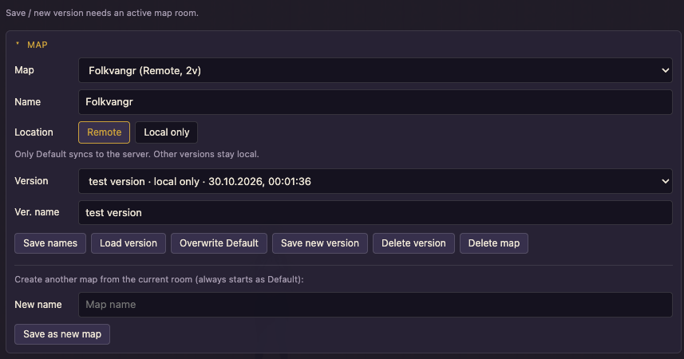

- Save the current map room as a new map — version is always **Default** (disabled outside a map room)  
- Only **Default** can sync to the server; other versions (e.g. Development / named local versions) stay in this browser  
- Toggle **Remote** vs **Local only** for Default; **Overwrite Default**; Save new version; Load / Delete  

- Export JSON (refresh / copy / download); **Choose file…** or paste — imports are **always Local only**  

Details: [ROOM_MANAGER.md](ROOM_MANAGER.md).

---

## Actions tab

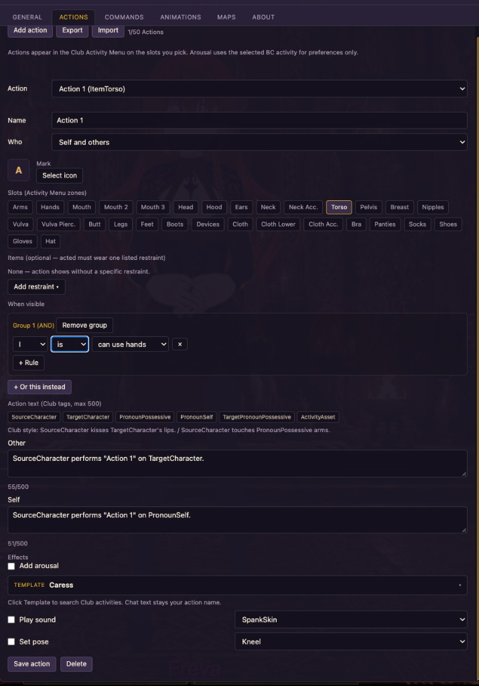

Full editor for **custom Activity Menu** entries (up to 50): identity, slots, chat, items, conditions, arousal template, sound, pose, icons, export/import.

These are **not** the same as **Commands → Actions** (those are `/a` shortcuts). Per-section screenshots and walkthrough: [ACTIONS.md](ACTIONS.md).

---

## Commands tab

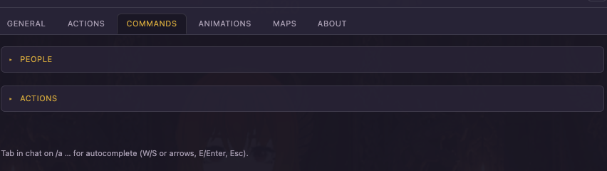

Chat slash-command setup: **People** aliases and **`/a` Action** bindings. Tab in chat on `/a …` for autocomplete (W/S or arrows, E/Enter, Esc).

### People — what to do

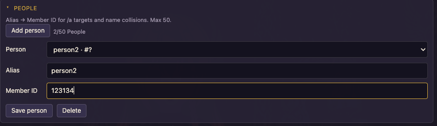

1. Click **Add person**.
2. Set an **Alias** (short name you type in chat) and **Member ID**.
3. **Save person**.
4. Use the Person dropdown later to edit or delete.

Aliases help when several people share a display name — Seidr resolves the Member ID you saved. Max **50**.

### Actions — what to do

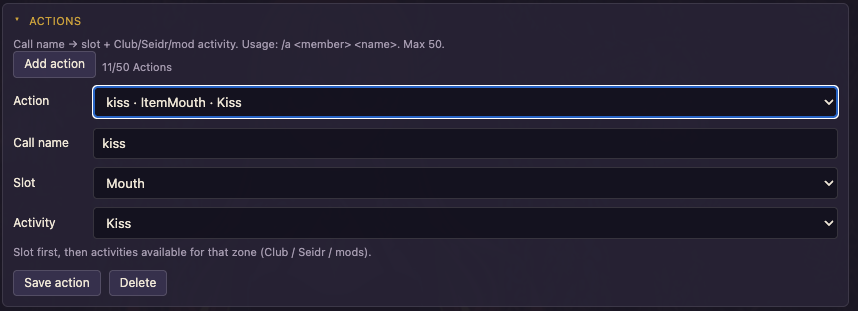

1. Click **Add action**.
2. Set a **call name** (what you type after the person in `/a`).
3. Pick **Slot** first (e.g. Mouth), then **Activity** for that slot.
4. **Save action**.

Pose / animation / undress / meta commands do **not** need rows here — they use built-in lists or the Animations tab. Max **50**.

In the chat box, **Tab** opens autocomplete. Full guide: [COMMANDS.md](COMMANDS.md).

---

## Animations tab

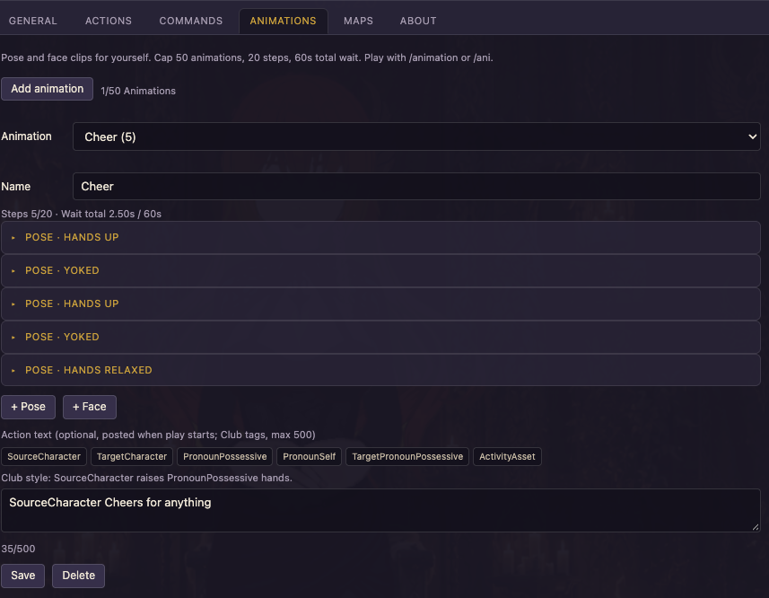

Author pose/face clips for the local Player (up to 50 animations, 20 steps, 60 s total wait). Play with `/animation` / `/ani`. Steps, face rows, and Action text screenshots: [ANIMATIONS.md](ANIMATIONS.md).

---

## About tab

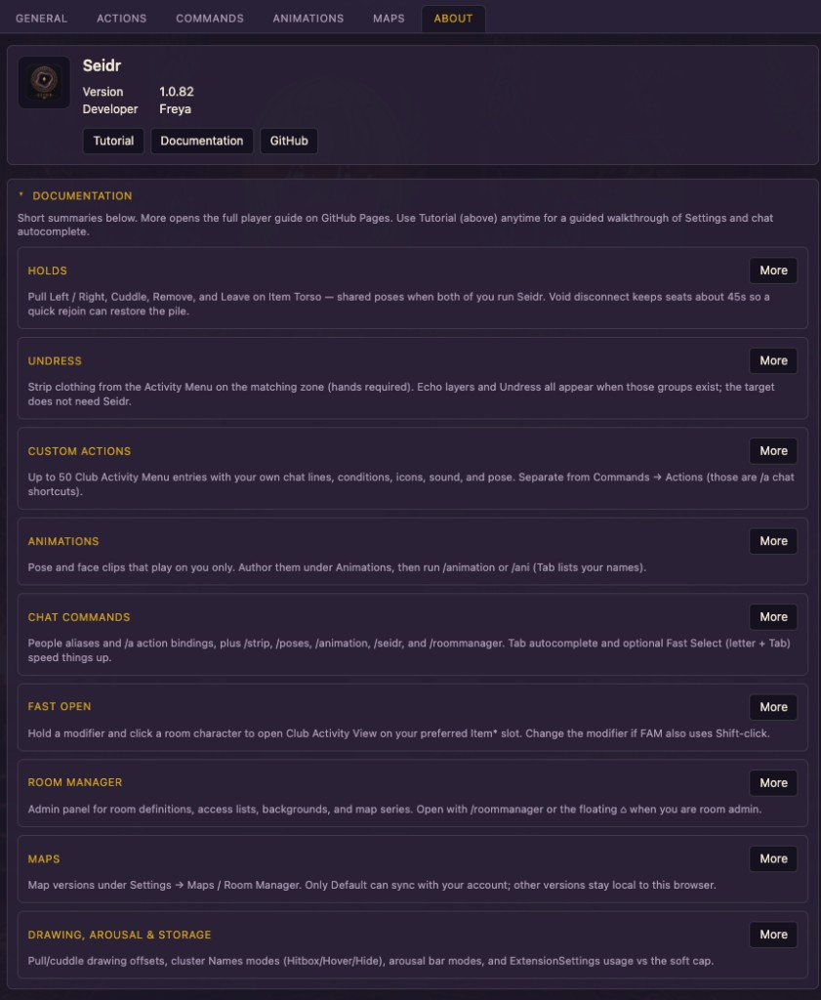

Plugin identity and documentation:

- **Version** (matches the loaded Seidr build) and **Developer** (Freya)  
- **Tutorial** — repeatable spotlight walkthrough of Settings and chat autocomplete (Skip / Esc anytime)  
- **Documentation** / **GitHub** — Pages home and public repository  
- Short feature blurbs with **More** → opens the matching Pages guide in a new tab  

First load in a chat room also posts a one-time sticky **Welcome** line in local chat (mentions `/seidr` and this Tutorial).

---

## Where settings are stored

All of the above (except background preview thumbs and **local-only** map versions) persist in:

`Player.ExtensionSettings.SeidrRoomManager`

Synced with your BC account via Club ExtensionSettings. Preview thumbnails for Room Manager backgrounds and local-only map versions use **localStorage**.
